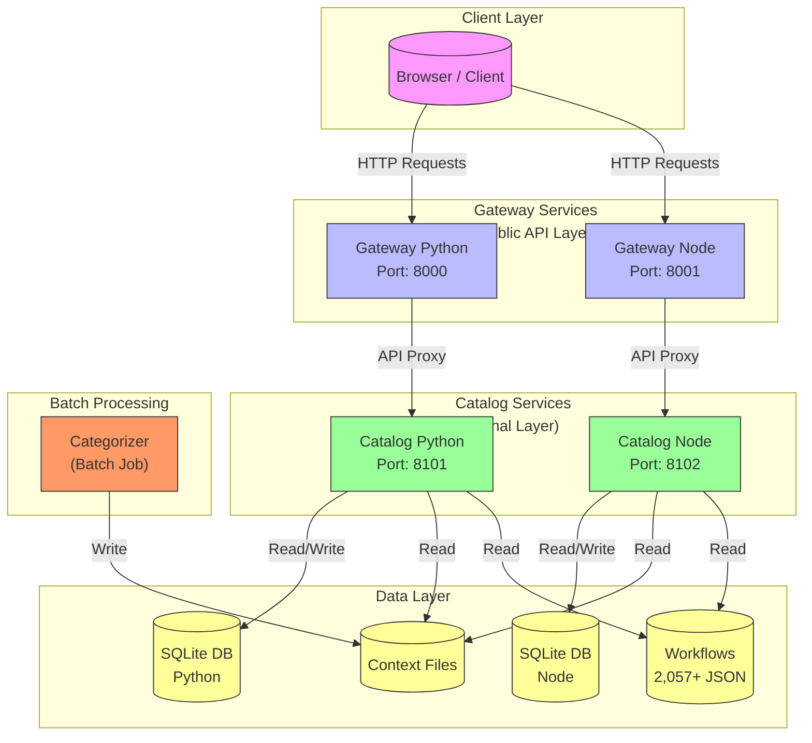
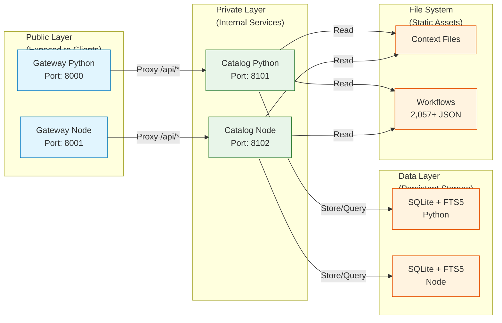
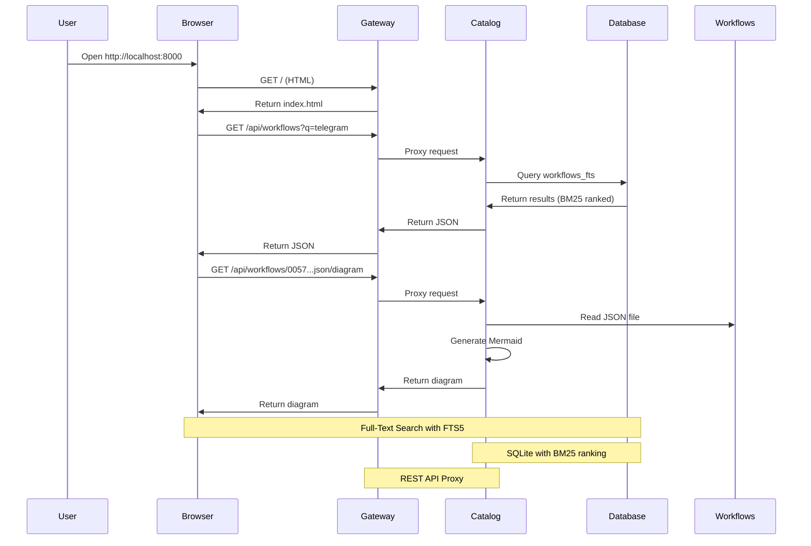
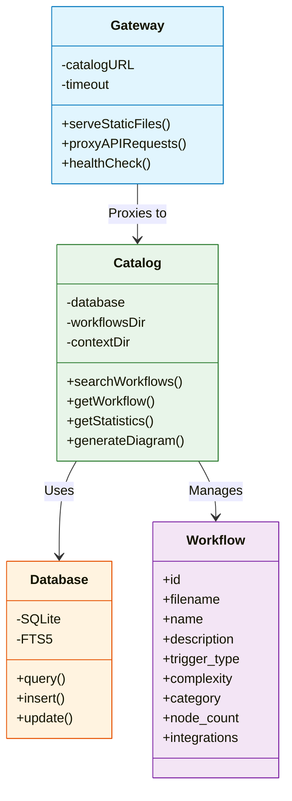

# n8n Workflow Collection & Documentation

**By AceIntelligence Systems** | **Founders: OM CHOKSI & Yash Khare**

A curated collection of **2,057+ n8n workflows** with a **high-performance, searchable documentation system** built as **function-focused microservices** in both **Python** and **Node.js**.

> **IMPORTANT NOTICE (Aug 14, 2025):** Repository history has been rewritten due to DMCA compliance. If you have a fork or local clone, please see [Issue 85](https://github.com/FireFistisDead/n8n-workflows/issues/85) for instructions on syncing your copy.

---

## About AceIntelligence Systems

**AceIntelligence Systems** is a cutting-edge automation and AI integration company specializing in workflow automation, business process optimization, and intelligent system integration.

### Founding Team

|Name | Email | LinkedIn |
|------|-------|---------|
| OM CHOKSI | om@aceinteligence.systems | [linkedin.com/in/omchoksi](https://linkedin.com/in/omchoksi) |
| Yash Khare | yash@aceinteligence.systems | [linkedin.com/in/yashkhare](https://linkedin.com/in/yashkhare) |

### Company Information

- **Website**: [https://aceinteligence.systems](https://aceinteligence.systems)
- **Specialization**: Workflow Automation, AI Integration, n8n Solutions, Business Process Automation
- **Location**: Global (Remote-First)
- **Established**: 2024

---

## Architecture Overview

The system follows a **microservices architecture** with clear separation of concerns, designed for scalability, maintainability, and high performance.

### System Architecture Diagram



### Microservices Communication Flow



### Request Flow Diagram



### Service Architecture Details



### Service Breakdown

| Service | Python Port | Node Port | Responsibility | Access |
|---------|-------------|-----------|----------------|--------|
| **Catalog** | 8101 | 8102 | Database, indexing, search, stats, diagrams | Private |
| **Gateway** | 8000 | 8001 | Static files, API proxy, health checks | Public |
| **Categorizer** | N/A | N/A | Category generation (batch job) | On-demand |

---

## Source Layout

```
n8n-templates/
├── README.md                          # Project documentation (this file)
├── docker-compose.yml                 # Docker orchestration
├── Dockerfile                         # Multi-stage build (Python + Node)
├── .devcontainer/                     # Dev container configuration
│   └── devcontainer.json
├── .dockerignore                      # Docker ignore patterns
├── .gitignore                         # Git ignore patterns
│
├── client/                            # Web client (static files)
│   ├── index.html                     # Main HTML page
│   └── assets/                        # CSS, JS, images
│       ├── css/
│       │   └── styles.css
│       └── js/
│           ├── state.js              # State management
│           ├── api.js                # API client
│           ├── theme.js              # Theme management
│           ├── workflows.js          # Workflow logic
│           ├── render.js             # Rendering logic
│           ├── modal.js              # Modal dialogs
│           ├── diagram.js            # Diagram rendering
│           └── app.js                # Main application
│
├── context/                           # Category definitions and mappings
│   ├── def_categories.json            # Curated integration -> category definitions (726+ entries)
│   ├── search_categories.json         # Generated filename -> category mappings
│   └── unique_categories.json        # Generated list of unique categories (16 categories)
│
├── data/                              # SQLite databases (gitignored)
│   ├── python/
│   │   └── workflows.db              # Python catalog database
│   └── node/
│       └── workflows.db              # Node catalog database
│
├── scripts/                           # Launch and management scripts
│   ├── catalog-python.sh              # Start Python catalog
│   ├── catalog-node.sh                # Start Node catalog
│   ├── gateway-python.sh              # Start Python gateway
│   ├── gateway-node.sh                # Start Node gateway
│   ├── categorize-python.sh           # Run Python categorizer
│   ├── categorize-node.sh             # Run Node categorizer
│   ├── dev-python.sh                  # Start Python dev stack (catalog + gateway)
│   ├── dev-node.sh                    # Start Node dev stack (catalog + gateway)
│   ├── index-workflows.sh             # Index all workflows
│   └── run-as-docker-container.sh     # Run as Docker container
│
├── services/                          # Service implementations
│   ├── python/                        # Python microservices
│   │   ├── catalog/
│   │   │   ├── __main__.py
│   │   │   ├── config.py
│   │   │   ├── contracts.py
│   │   │   ├── api/
│   │   │   │   ├── app.py
│   │   │   │   ├── dependencies.py
│   │   │   │   ├── routes_admin.py
│   │   │   │   ├── routes_categories.py
│   │   │   │   ├── routes_stats.py
│   │   │   │   └── routes_workflows.py
│   │   │   ├── cli/
│   │   │   │   └── index.py
│   │   │   ├── db/
│   │   │   │   ├── connection.py
│   │   │   │   ├── fts_query.py
│   │   │   │   ├── schema.py
│   │   │   │   └── workflow_repository.py
│   │   │   ├── domain/
│   │   │   │   ├── analyzer.py
│   │   │   │   ├── categories.py
│   │   │   │   ├── description.py
│   │   │   │   ├── diagram.py
│   │   │   │   ├── integrations.py
│   │   │   │   └── naming.py
│   │   │   └── services/
│   │   │       ├── category_service.py
│   │   │       ├── index_service.py
│   │   │       ├── search_service.py
│   │   │       ├── stats_service.py
│   │   │       ├── workflow_files.py
│   │   │       └── workflow_service.py
│   │   │
│   │   ├── gateway/
│   │   │   ├── __main__.py
│   │   │   ├── app.py
│   │   │   ├── catalog_client.py
│   │   │   └── routes/
│   │   │       ├── pages.py
│   │   │       └── proxy.py
│   │   │
│   │   ├── categorizer/
│   │   │   ├── __main__.py
│   │   │   ├── defs.py
│   │   │   ├── rules.py
│   │   │   └── runner.py
│   │   │
│   │   └── requirements.txt
│   │
│   └── node/                           # Node.js microservices
│       ├── catalog/
│       │   ├── src/
│       │   │   ├── index.js
│       │   │   ├── config.js
│       │   │   ├── contracts.js
│       │   │   ├── api/
│       │   │   │   ├── app.js
│       │   │   │   ├── routesAdmin.js
│       │   │   │   ├── routesWorkflows.js
│       │   │   │   ├── routesCategories.js
│       │   │   │   └── routesStats.js
│       │   │   ├── db/
│       │   │   │   ├── connection.js
│       │   │   │   ├── schema.js
│       │   │   │   ├── ftsQuery.js
│       │   │   │   └── workflowRepository.js
│       │   │   ├── domain/
│       │   │   │   ├── analyzer.js
│       │   │   │   ├── categories.js
│       │   │   │   ├── description.js
│       │   │   │   ├── diagram.js
│       │   │   │   ├── integrations.js
│       │   │   │   └── naming.js
│       │   │   ├── services/
│       │   │   │   ├── context.js
│       │   │   │   ├── indexService.js
│       │   │   │   ├── searchService.js
│       │   │   │   ├── statsService.js
│       │   │   │   ├── workflowFiles.js
│       │   │   │   ├── categoryService.js
│       │   │   │   └── workflowService.js
│       │   │   └── cli/
│       │   │       └── index.js
│       │   └── package.json
│       │
│       └── gateway/
│           └── src/
│               ├── index.js
│               ├── config.js
│               ├── catalogClient.js
│               └── routes/
│                   ├── pages.js
│                   └── proxy.js
│
└── workflows/                          # Workflow JSON files
    ├── Activecampaign/
    │   └── 0057_Activecampaign_Create_Triggered.json
    ├── Airtable/
    │   ├── 0001_Airtable_Create_Triggered.json
    │   └── ...
    ├── Asana/
    ├── Discord/
    ├── Gmail/
    ├── Google/
    ├── Slack/
    ├── Telegram/
    └── ... (188+ integration folders)
        └── 2,057+ workflow JSON files
```

---

## Key Features

### Core Capabilities

1. **Comprehensive Workflow Collection**
   - 2,057+ curated n8n workflows
   - 188+ integration categories
   - 96+ unique integrations supported
   - 29,528+ total nodes across all workflows

2. **Advanced Search & Filtering**
   - Full-text search with SQLite FTS5
   - BM25 ranking algorithm for relevance
   - Filter by trigger type, complexity, category
   - Active/inactive workflow filtering
   - Pagination support

3. **Intelligent Categorization**
   - 16 well-defined categories
   - Two-tier categorization system:
     - Definition-based (726+ integration mappings)
     - Rule-based (keyword matching fallback)
   - Automatic category assignment

4. **Statistics & Analytics**
   - Real-time collection statistics
   - Trigger distribution analysis
   - Complexity metrics
   - Integration usage tracking

5. **Visualization**
   - Mermaid.js diagram generation
   - Interactive workflow visualization
   - Node and connection mapping

6. **Dual-Stack Implementation**
   - Python (FastAPI) implementation
   - Node.js (Express) implementation
   - Identical JSON contracts
   - Same algorithms and logic
   - Can run both simultaneously

---

## Quick Start

### Prerequisites

- **Python 3.10+** (for Python stack)
- **Node.js 22.5+** (for Node stack)
- **Docker & Docker Compose** (for containerized deployment)
- **Git** (for cloning)

### Option 1: Python Stack (Recommended for Development)

```bash
# Install dependencies
pip install -r services/python/requirements.txt

# Run catalog service (indexes on first run)
./scripts/catalog-python.sh        # http://127.0.0.1:8101

# Run gateway service
./scripts/gateway-python.sh        # http://127.0.0.1:8000

# Or run both together
./scripts/dev-python.sh
```

**Access**: http://localhost:8000

### Option 2: Node Stack

```bash
# Run catalog service (installs deps on first run)
./scripts/catalog-node.sh          # http://127.0.0.1:8102

# Run gateway service
./scripts/gateway-node.sh          # http://127.0.0.1:8001

# Or run both together
./scripts/dev-node.sh
```

**Access**: http://localhost:8001

### Option 3: Docker (Production-Ready)

```bash
# Build and run all services
docker-compose up -d

# Wait for services to start (60-90 seconds)
# Python gateway: http://localhost:8000
# Node gateway:   http://localhost:8001
```

**Access**:
- Python: http://localhost:8000
- Node: http://localhost:8001

---

## Collection Statistics

### Overview

| Metric | Value |
|--------|-------|
| **Total Workflows** | 2,057 |
| **Active Workflows** | 217 |
| **Inactive Workflows** | 1,840 |
| **Total Nodes** | 29,528 |
| **Unique Integrations** | 96 |
| **Categories** | 16 |
| **Subdirectories** | 188 |

### Trigger Distribution

| Trigger Type | Count | Percentage |
|--------------|-------|------------|
| Webhook | 713 | 34.7% |
| Complex | 619 | 30.1% |
| Manual | 414 | 20.1% |
| Scheduled | 311 | 15.1% |

### Complexity Distribution

| Complexity | Count | Percentage | Node Range |
|------------|-------|------------|------------|
| Low | 566 | 27.5% | <=5 nodes |
| Medium | 775 | 37.7% | 6-15 nodes |
| High | 716 | 34.8% | 16+ nodes |

### Available Categories

1. **AI Agent Development** - OpenAI, Anthropic, Hugging Face, LangChain
2. **Business Process Automation** - Noop, Code, Schedule, Filter, Wait
3. **Cloud Storage & File Management** - AWS S3, Google Drive, Dropbox, OneDrive
4. **Communication & Messaging** - Telegram, Slack, Discord, WhatsApp, Email
5. **Creative Content & Video Automation** - YouTube, Vimeo, Storyblok
6. **Creative Design Automation** - Canva, Figma, Bannerbear
7. **CRM & Sales** - HubSpot, Salesforce, Pipedrive, Copper
8. **Data Processing & Analysis** - PostgreSQL, MySQL, MongoDB, Airtable
9. **E-commerce & Retail** - Shopify, WooCommerce, Stripe, PayPal
10. **Financial & Accounting** - Stripe, Chargebee, QuickBooks
11. **Marketing & Advertising Automation** - Mailchimp, SendGrid, ActiveCampaign
12. **Project Management** - Jira, GitHub, GitLab, Trello, Asana
13. **Social Media Management** - LinkedIn, Twitter/X, Facebook, Instagram
14. **Technical Infrastructure & DevOps** - Git, Travis CI, Jenkins, AWS
15. **Web Scraping & Data Extraction** - Webhook, HTTP, RSS Feed
16. **Uncategorized** - Workflows awaiting categorization

---

## Configuration

### Environment Variables

All services read environment variables and resolve paths from the repository root.

#### Catalog Service

| Variable | Default | Description |
|----------|---------|-------------|
| `N8N_REPO_ROOT` | auto-detected | Repository root path |
| `N8N_WORKFLOWS_DIR` | `<root>/workflows` | Workflows directory |
| `N8N_CONTEXT_DIR` | `<root>/context` | Context files directory |
| `N8N_DB_PATH` | `data/python/workflows.db` | Database path (Python) |
| `N8N_DB_PATH` | `data/node/workflows.db` | Database path (Node) |
| `N8N_AUTO_INDEX` | `true` | Auto-index on startup |
| `CATALOG_HOST` | `127.0.0.1` | Catalog host |
| `CATALOG_PORT` | `8101` (Python) / `8102` (Node) | Catalog port |

#### Gateway Service

| Variable | Default | Description |
|----------|---------|-------------|
| `N8N_REPO_ROOT` | auto-detected | Repository root path |
| `N8N_CLIENT_DIR` | `<root>/client` | Client files directory |
| `CATALOG_URL` | `http://127.0.0.1:8101` (Python) / `8102` (Node) | Catalog URL |
| `CATALOG_TIMEOUT_SECONDS` | `60` | Catalog timeout (Python) |
| `CATALOG_TIMEOUT_MS` | `60000` | Catalog timeout (Node) |
| `GATEWAY_HOST` | `127.0.0.1` | Gateway host |
| `GATEWAY_PORT` | `8000` (Python) / `8001` (Node) | Gateway port |

---

## API Documentation

### Base URL

- Python Gateway: `http://localhost:8000/api`
- Node Gateway: `http://localhost:8001/api`

### Endpoints

| Method | Path | Description |
|--------|------|-------------|
| `GET` | `/health` | Service health check |
| `GET` | `/api/stats` | Collection statistics |
| `GET` | `/api/integrations` | List all unique integrations |
| `GET` | `/api/categories` | List all categories |
| `GET` | `/api/category-mappings` | Get filename -> category mappings |
| `GET` | `/api/workflows` | Search and filter workflows |
| `GET` | `/api/workflows/category/{category}` | Workflows by category |
| `GET` | `/api/workflows/{filename}` | Get workflow metadata + raw JSON |
| `GET` | `/api/workflows/{filename}/diagram` | Get Mermaid diagram |
| `GET` | `/api/workflows/{filename}/download` | Download workflow JSON |
| `POST` | `/api/reindex?force=true` | Trigger reindexing |

### Query Parameters for `/api/workflows`

| Parameter | Type | Default | Description |
|-----------|------|---------|-------------|
| `q` | string | "" | Search query (full-text search) |
| `trigger` | string | "all" | Filter by trigger type (Webhook, Scheduled, Manual, Complex, all) |
| `complexity` | string | "all" | Filter by complexity (low, medium, high, all) |
| `category` | string | "all" | Filter by category |
| `active_only` | boolean | false | Filter to active workflows only |
| `page` | integer | 1 | Page number (1-based) |
| `per_page` | integer | 20 | Items per page (1-100) |

### Example Requests

```bash
# Get collection statistics
curl http://localhost:8000/api/stats

# Search workflows
curl "http://localhost:8000/api/workflows?q=telegram&category=Communication%20%26%20Messaging"

# List all integrations
curl http://localhost:8000/api/integrations

# Get a workflow's diagram
curl http://localhost:8000/api/workflows/0748_Noop_Telegram_Automation_Scheduled.json/diagram

# Download a workflow
curl http://localhost:8000/api/workflows/0057_Activecampaign_Create_Triggered.json/download -o workflow.json
```

### Response Formats

#### Workflow Summary

```json
{
  "id": 1,
  "filename": "0057_Activecampaign_Create_Triggered.json",
  "name": "ActiveCampaign Create Triggered",
  "active": false,
  "description": "Receive updates when a new account is added by an admin in ActiveCampaign",
  "trigger_type": "Triggered",
  "complexity": "low",
  "category": "Marketing & Advertising Automation",
  "node_count": 1,
  "integrations": ["ActiveCampaign"],
  "tags": [],
  "folder": "Activecampaign",
  "created_at": "2024-01-01T00:00:00Z",
  "updated_at": "2024-01-01T00:00:00Z"
}
```

#### Statistics Response

```json
{
  "total": 2057,
  "active": 217,
  "inactive": 1840,
  "triggers": {
    "Webhook": 713,
    "Complex": 619,
    "Manual": 414,
    "Scheduled": 311
  },
  "complexity": {
    "low": 566,
    "medium": 775,
    "high": 716
  },
  "total_nodes": 29528,
  "unique_integrations": 96,
  "last_indexed": "2025-01-01T12:00:00Z"
}
```

---

## Indexing & Categories

### Indexing Workflows

The catalog automatically indexes all workflow JSON files recursively under `workflows/`.

```bash
# Incremental indexing (skips unchanged files by MD5)
./scripts/index-workflows.sh python

# Force re-index all workflows
./scripts/index-workflows.sh python --force

# Stats only (no indexing)
./scripts/index-workflows.sh python --stats

# Node equivalents
./scripts/index-workflows.sh node --force
```

### Categorization

Workflows are categorized using a two-tier system:

1. **Definition-based**: Matches integration names against `context/def_categories.json`
2. **Rule-based**: Falls back to keyword matching in `services/python/categorizer/rules.py`

```bash
# Regenerate category files
./scripts/categorize-python.sh
./scripts/categorize-node.sh

# Then re-index
./scripts/index-workflows.sh python --force
```

### Upgrading Database

The schema is versioned (`PRAGMA user_version`). If upgrading from an older version:

```bash
# The category column was added in version 3
# Run this once after upgrading
./scripts/index-workflows.sh python --force
```

---

## Web Client Features

### User Interface

- **Instant Search**: Full-text search with FTS5 (results in milliseconds)
- **Advanced Filtering**: Filter by trigger, complexity, category, active status
- **Pagination**: 20 items per page with stable ordering
- **Diagram Viewer**: Interactive Mermaid.js workflow visualization
- **Dark Mode**: Theme toggle for comfortable viewing
- **Responsive Design**: Works on desktop, tablet, and mobile

### Technology Stack

- **Frontend**: Vanilla JavaScript (no framework dependencies)
- **Styling**: Custom CSS with modern design
- **Diagrams**: Mermaid.js for workflow visualization
- **State Management**: Custom state management
- **API Client**: Fetch-based HTTP client

---

## Workflow Naming Convention

Workflows follow a consistent naming pattern:

```
<id>_<Service>_<Goal>_<Trigger>.json
```

Examples:
- `0057_Activecampaign_Create_Triggered.json`
- `1234_HTTP_Slack_Create_Webhook.json`
- `0748_Noop_Telegram_Automation_Scheduled.json`

### Display Name Formatting

Filenames are automatically converted to human-readable names:
- `1234_HTTP_Slack_Create_Webhook.json` -> `HTTP Slack Create Webhook`
- Leading numeric prefixes are removed
- Special terms are normalized (HTTP, API, JSON, etc.)
- Words are title-cased

---

## Importing Workflows into n8n

1. Open your n8n editor
2. Choose **Import workflow**
3. Select any JSON file from `workflows/` directory
4. Update credentials and webhook URLs before running

---

## Contributing

We welcome contributions from the community! Here's how to contribute:

### Adding New Workflows

1. Add workflow JSON files under `workflows/` (subfolders are supported)
2. Follow the naming convention: `<id>_<Service>_<Goal>_<Trigger>.json`
3. Run the categorizer:
   ```bash
   ./scripts/categorize-python.sh
   ```
4. Reindex the catalog:
   ```bash
   ./scripts/index-workflows.sh python --force
   ```
5. Verify the stats:
   ```bash
   curl http://localhost:8000/api/stats
   ```

### Updating Categories

Edit `context/def_categories.json` to add new integration-to-category mappings:

```json
{
  "integration": "NewIntegration",
  "category": "Category Name"
}
```

Then regenerate category files and reindex.

For detailed contribution guidelines, see [CONTRIBUTING.md](CONTRIBUTING.md)

---

## License

This project is licensed under the **MIT License** - see the [LICENSE](LICENSE) file for details.

---

## Support & Contact

### Support My Work

[](https://buymeacoffee.com/firefistisdead)

### Contact Information

For business inquiries, partnerships, or support:

- **Website**: [https://aceinteligence.systems](https://aceinteligence.systems)
- **Email**: contact@aceinteligence.systems
- **Founder**: OM CHOKSI - om@aceinteligence.systems
- **Co-Founder**: Yash Khare - yash@aceinteligence.systems

### Professional Services

AceIntelligence Systems offers professional services including:

- **n8n Workflow Development**: Custom workflow automation solutions
- **System Integration**: Connecting your tools and services
- **AI Integration**: Adding AI capabilities to your workflows
- **Consulting**: Expert advice on automation strategy
- **Training**: Workshops and training sessions
- **Support**: Ongoing maintenance and support

Visit [https://aceinteligence.systems](https://aceinteligence.systems) for more information.

---

## Additional Resources

- [n8n Official Documentation](https://docs.n8n.io/)
- [n8n Community Forum](https://community.n8n.io/)
- [n8n GitHub](https://github.com/n8n-io/n8n)
- [AceIntelligence Systems](https://aceinteligence.systems)

---

## Acknowledgments

- **n8n Team**: For building an amazing workflow automation tool
- **Open Source Community**: For contributions and feedback
- **All Contributors**: For helping improve this collection

---

**Built with love by AceIntelligence Systems**

*OM CHOKSI & Yash Khare*

*Copyright 2025 AceIntelligence Systems. All rights reserved.*
